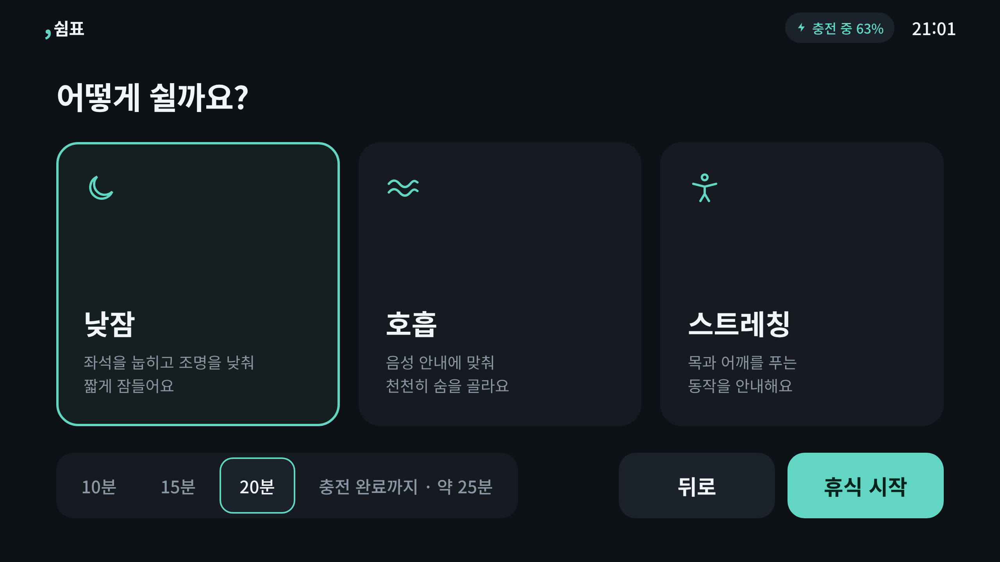
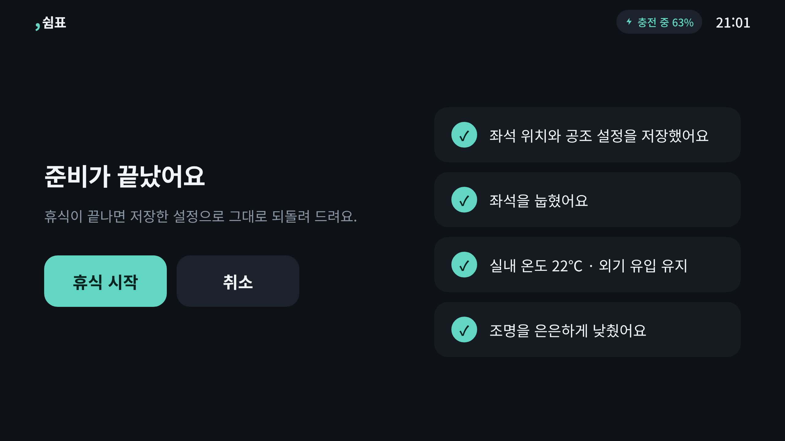
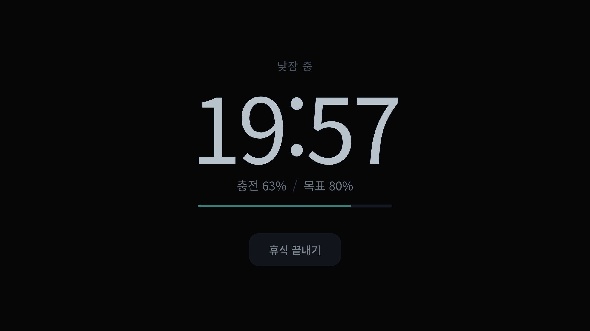
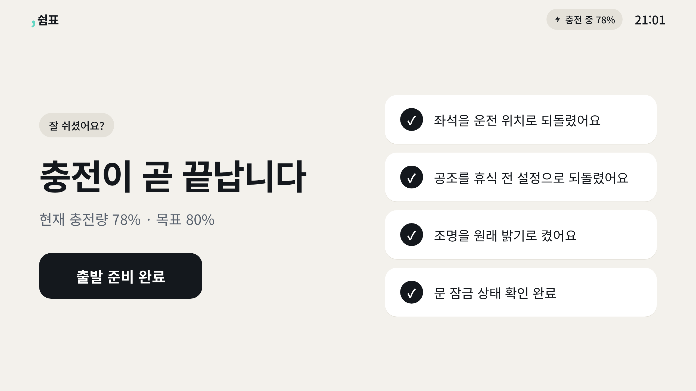
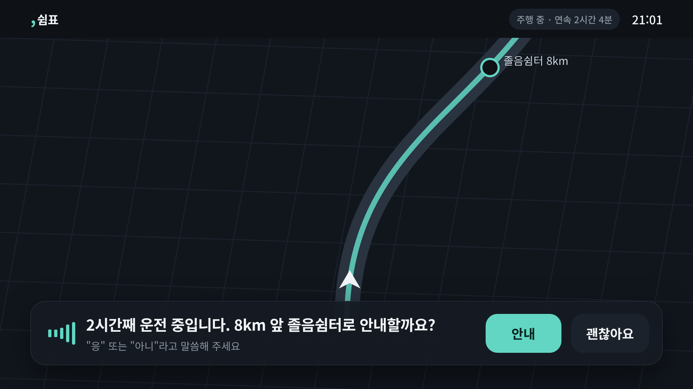
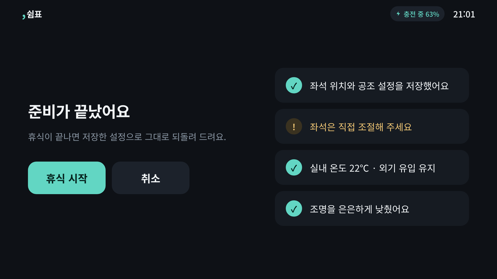

# , 쉼표

**충전 대기와 정차 시간을 휴식 시간으로 바꾸는 차량용 앱**

쉼표는 전기차 충전 대기 시간과 장거리 운전 중 정차 시간에 좌석, 공조, 조명, 음성 안내를 한 번에 맞춰 차 안을 휴식 공간으로 바꾸고, 충전이 끝나는 시점에 맞춰 깨워 주는 Pleos Connect 앱입니다.

> **현재 단계: UI 프로토타입**
> 이 저장소에는 브라우저에서 동작하는 시연 화면(`demo-web/`)과 실제 앱의 코드 구조 틀(`android/`)이 들어 있습니다.
> 차량 연동(Vehicle SDK 호출)은 아직 구현하지 않았습니다. 시연 화면의 충전량, 시간, 차량 상태는 모두 가짜 데이터입니다.

---

## 화면

| 1. 휴식 제안 | 2. 휴식 종류 선택 |
| --- | --- |
|  |  |
| **3. 준비 중** | **4. 휴식 중** |
|  |  |
| **5. 기상과 복귀** | **6. 휴식 권유(주행 중)** |
|  |  |

좌석 제어를 쓸 수 없는 차량(부분 모드)에서는 준비 화면이 이렇게 바뀝니다.



화면은 1280×720 가로 화면과 어두운 배경을 가정해 만들었습니다. Pleos Connect Emulator의 실제 해상도는 아직 확인하지 않았습니다.

## 핵심 기능

| 기능 | 하는 일 | 사용할 차량 요소 |
| --- | --- | --- |
| 휴식 제안 | 충전 시작이나 주차 브레이크 체결을 감지해 휴식 모드를 먼저 제안 | EvBattery, Brake |
| 원터치 휴식 모드 | 좌석 눕힘, 온도와 풍량 조절, 조명 낮춤을 한 번에 실행 | Seat, HVAC, Light |
| 휴식 프로그램 | 호흡 안내, 낮잠, 스트레칭을 음성으로 안내 | TextToSpeech SDK |
| 맞춤 기상 | 충전 목표 도달이나 타이머 종료에 맞춰 조명을 밝히고 음성으로 깨움 | EvBattery, Light, TextToSpeech SDK |
| 원상 복귀 | 휴식 전 좌석과 공조 설정을 저장했다가 되돌림 | Seat, HVAC |
| 음성 비서 연동 | Gleo AI로 휴식 시작, 종료, 남은 시간 확인 | Gleo Interface |
| 휴식 권유 | 연속 주행 2시간이 넘으면 음성으로 휴식을 권하고 졸음쉼터로 안내 | Odometer, NaviHelper SDK |

**안전 원칙**: 휴식 모드는 정차 상태에서만 시작합니다. 휴식 중 주차 브레이크가 풀리거나 `ERROR_DRIVING_RESTRICTED`를 받으면 즉시 모드를 끝내고 좌석을 되돌립니다. 주행 중에는 음성으로만 동작합니다.

## APK

이번 제출에는 APK 파일을 포함하지 않았습니다.

APK 소스는 `apk-app/`에 있습니다. 아래 시연 화면(demo-web)을 앱 안에 넣어 전체 화면 WebView로 띄우는 **UI 프로토타입**이며, 차량 데이터는 가짜 값이고 Vehicle SDK와 연결되어 있지 않습니다. Android 9(API 28) 이상, 가로 화면 기준입니다.

### APK 직접 빌드

JDK 17과 Android SDK가 필요합니다.

```bash
cd demo-web && npm install && npm run build:apk   # 시연 화면을 apk-app/app/src/main/assets/index.html 한 파일로 빌드
cd ../apk-app && ./gradlew assembleRelease        # 결과: app/build/outputs/apk/release/
```

Android Studio에서 `apk-app` 폴더를 열고 빌드해도 됩니다. 만든 APK는 `adb install <파일>`로 설치하거나 에뮬레이터 창에 끌어다 놓으면 설치됩니다.

## 테스트 환경

| 항목 | 내용 |
| --- | --- |
| 화면 규격 | 1280×720 가로 화면 기준으로 디자인. 다른 해상도에서는 비율을 유지한 채 화면 가운데에 맞춰 축소됨 |
| Pleos Connect 에뮬레이터 | 아직 Pleos Connect Emulator에서 실행 검증하지 않았습니다. 에뮬레이터의 실제 해상도에 맞춘 조정은 2단계에서 합니다. |
| 시연 화면 확인 | Chrome 브라우저 (1280×720) |
| 필요한 설정 | 없음. 차량 퍼미션, 네트워크, 계정이 필요하지 않습니다. |

## 시연 화면 실행 (demo-web)

Node.js 18 이상이 필요합니다.

```bash
cd demo-web
npm install
npm run dev
```

터미널에 나온 주소(기본 `http://localhost:5173`)를 브라우저에서 엽니다.

| 주소 옵션 | 동작 |
| --- | --- |
| `?screen=1` ~ `?screen=6` | 해당 화면을 바로 띄움 (캡처용) |
| `?mode=partial` / `?mode=basic` | 부분 모드 / 기본 모드로 준비·복귀 화면 표시 |
| `?speed=60` | 휴식 타이머를 60배 빠르게 진행 (시연용) |

버튼을 누르면 1 → 2 → 3 → 4 → 5 → 6 순서로 넘어갑니다. 준비 중 화면은 항목이 차례로 완료되고, 휴식 중 화면은 타이머와 충전량이 실제로 변합니다. 차량 데이터는 `src/vehicle/FakeVehicle.ts` 한 곳에서 가짜 값으로 만듭니다.

## 저장소 구성

```
apk-app/                       APK 소스 (시연 화면을 WebView로 띄우는 안드로이드 앱)
demo-web/                      시연용 화면 (Vite + React + TypeScript)
  src/screens/                 화면 6개
  src/vehicle/FakeVehicle.ts   가짜 차량 데이터 (충전 중, 충전량 증가)
android/                       실제 앱의 코드 구조 틀 (아직 빌드하지 않음)
  app/src/main/
    AndroidManifest.xml        조회 퍼미션, Gleo intent-filter
    assets/schema.json         Gleo App Schema 초안
    java/com/shimpyo/app/
      vehicle/                 VehicleRepository 인터페이스, Fake 구현, Pleos 구현 자리
      session/                 RestSessionController (상태 흐름, 완전/부분/기본 모드)
      gleo/                    Gleo Action 수신, Callback 전송
      ui/                      화면 목록
docs/screenshots/              화면 캡처
```

### 구조

```
UI (화면 6개)
  ↓
RestSessionController   대기 → 제안 → 준비 → 휴식 → 기상 → 복귀 → 대기
  ↓
VehicleRepository (인터페이스)
  ├─ FakeVehicleRepository    1단계: 가짜 데이터  ← 현재
  └─ PleosVehicleRepository   2단계 이후: Vehicle SDK 호출
```

차량 호출을 인터페이스 뒤에 두어, 실제 SDK 연결 전에도 화면과 세션 로직을 먼저 만들고 검증할 수 있게 했습니다. `PleosVehicleRepository`의 메서드는 아직 `TODO("API Reference 확인 후 연결")` 상태입니다.

## 사용 예정 SDK와 도메인

기준 버전: Vehicle SDK v2.3.2 (`ai.pleos.playground:Vehicle:2.3.2`)

| 도메인 / SDK | 용도 | API 타입 | 조회 퍼미션 | 제어 퍼미션 |
| --- | --- | --- | --- | --- |
| EvBattery | 충전 시작·종료 감지, 충전량 | Callback, Get | CAR_ENERGY | 불필요 |
| Brake | 주차 브레이크로 정차 판단 | Callback, Get | CAR_DRIVE | 불필요 |
| Odometer | 트립 주행 시간으로 연속 운전 판단 | Get | CAR_DRIVE | 불필요 |
| Door | 휴식 전 잠금 상태 확인 | Get | CAR_DOORS | 불필요 |
| Seat | 위치 저장, 눕힘, 복귀 | Capability, Get, Set | CAR_SEATS | 필요 (승인 후) |
| HVAC | 온도·풍량 저장, 설정, 복귀 | Capability, Get, Set | CAR_CLIMATE | 필요 (승인 후) |
| Light | 앰비언트 라이트 낮춤, 서서히 밝힘 | Capability, Get, Set | CAR_LIGHTS | 필요 (승인 후) |
| TextToSpeech SDK | 호흡, 기상, 휴식 권유 음성 | | | |
| SpeechToText SDK | 휴식 권유 응답 인식 | | | |
| NaviHelper SDK | 졸음쉼터 경유지 추가 | | | |
| Gleo Interface | 음성 명령 3개 (`START_REST_MODE`, `END_REST_MODE`, `GET_REST_STATUS`) | | | |

제어 퍼미션은 Pleos App Market과 사전 협의해 승인된 범위 안에서만 선언합니다. 그래서 쉼표는 capability 확인 결과에 따라 세 모드로 동작하도록 설계했습니다.

| 모드 | 조건 | 동작 |
| --- | --- | --- |
| 완전 모드 | 좌석, 공조, 조명 모두 제어 가능 | 좌석 눕힘, 공조·조명 조절, 음성 안내, 원상 복귀 |
| 부분 모드 | 좌석 제어 불가, 공조나 조명은 가능 | 공조·조명 조절, 음성 안내, 좌석은 직접 조절 안내 |
| 기본 모드 | 조회만 가능 | 충전 연동 타이머, 음성 안내, 맞춤 기상 |

## 구현 계획

| 단계 | 목표 | 완료 기준 | 상태 |
| --- | --- | --- | --- |
| 1단계 | UI 프로토타입 | 화면 6개, 가짜 데이터로 흐름 동작, 코드 구조, schema.json 초안 | **진행 중 (현재)** |
| 2단계 | 기본 모드 | 에뮬레이터에서 충전 감지, 정차 감지, 타이머, 음성 안내, 맞춤 기상 | 예정 |
| 3단계 | 완전 모드 | 좌석·공조·조명 제어와 원상 복귀, 모드 전환, 오류 처리 검증 | 예정 |
| 4단계 | 연동과 승인 | Gleo 연동, 휴게소 안내, 제어 퍼미션 승인 협의 | 예정 |

2단계 전에 확인할 것: Seat·HVAC·Light·EvBattery·Brake의 실제 함수 이름과 파라미터, 좌석·공조·조명 제어 퍼미션 이름, EvBattery의 충전 상태 리스너와 잔여 충전 시간 제공 여부, 에뮬레이터의 충전·좌석·공조 시뮬레이션 지원 여부.

---

shimpyo-team
